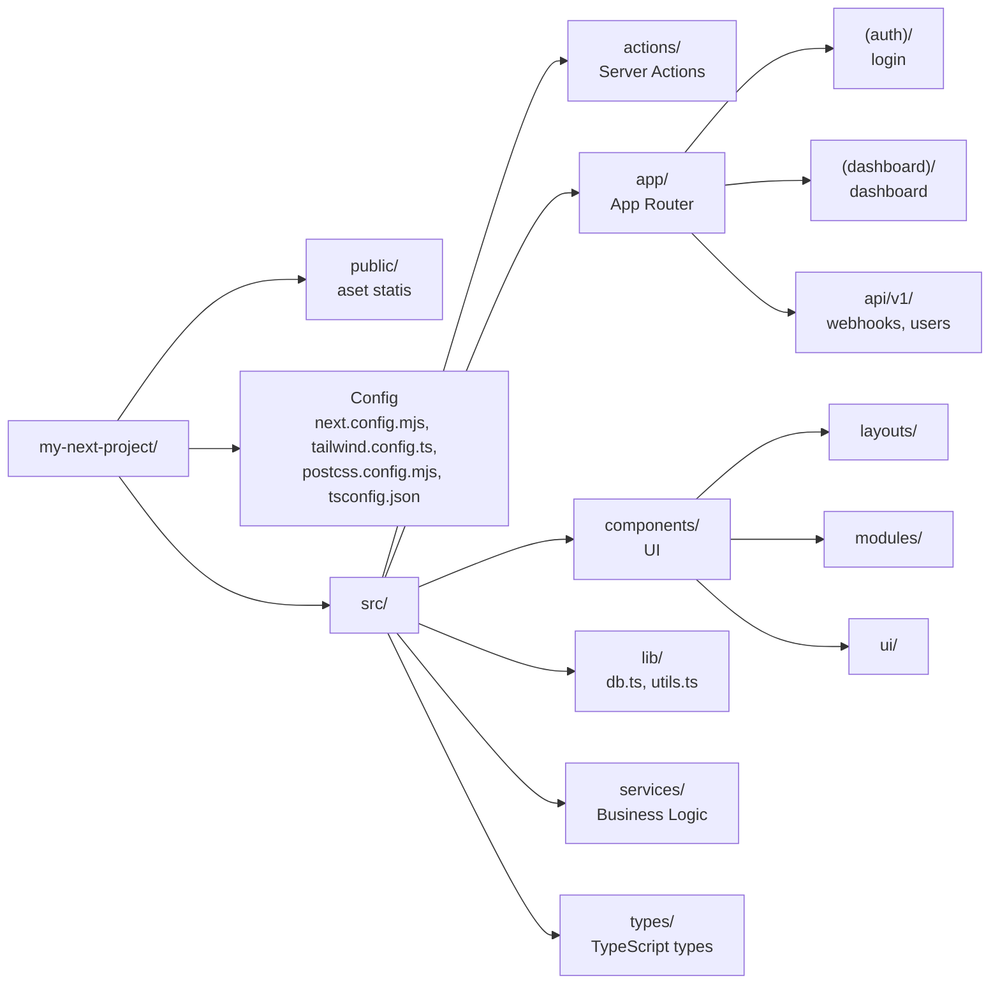
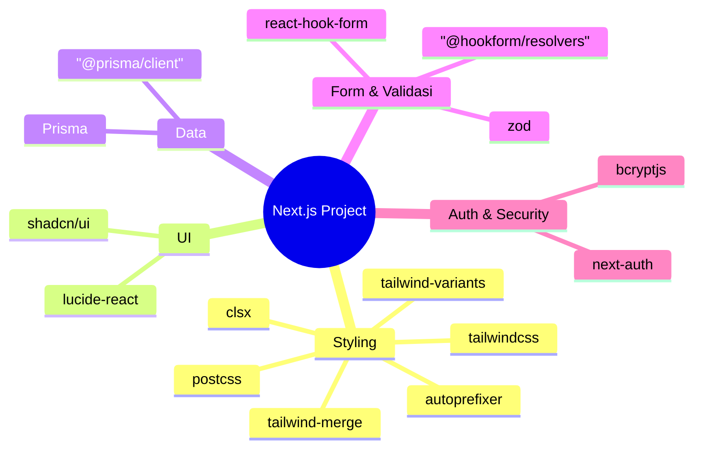
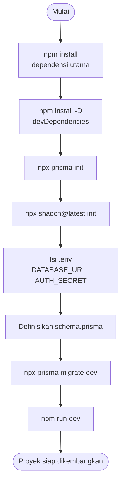
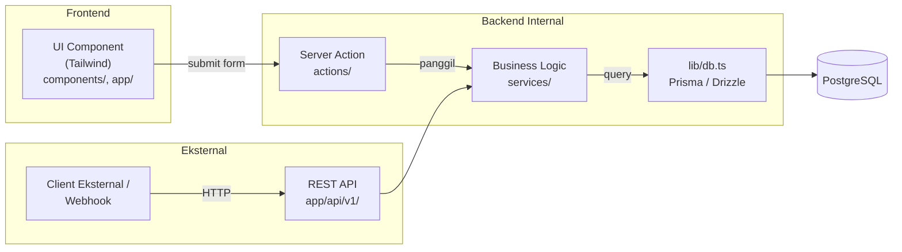
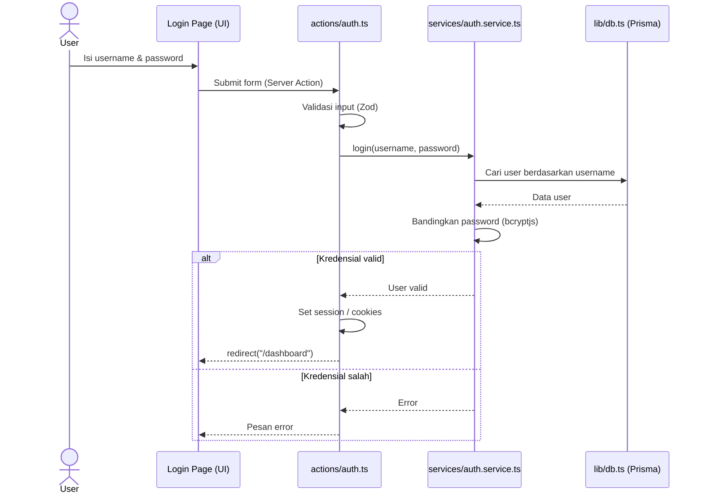
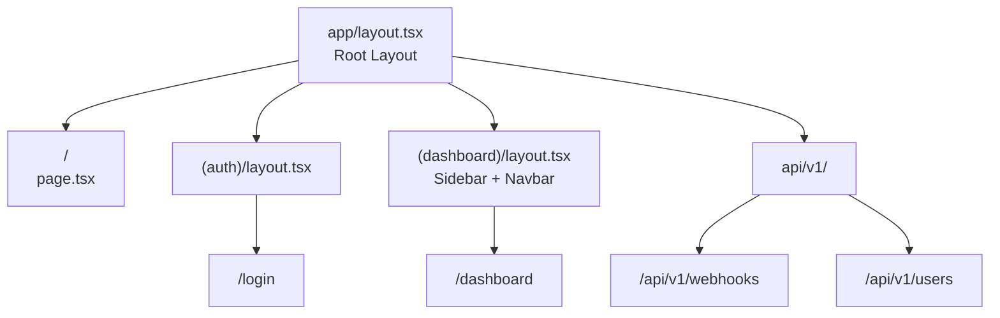
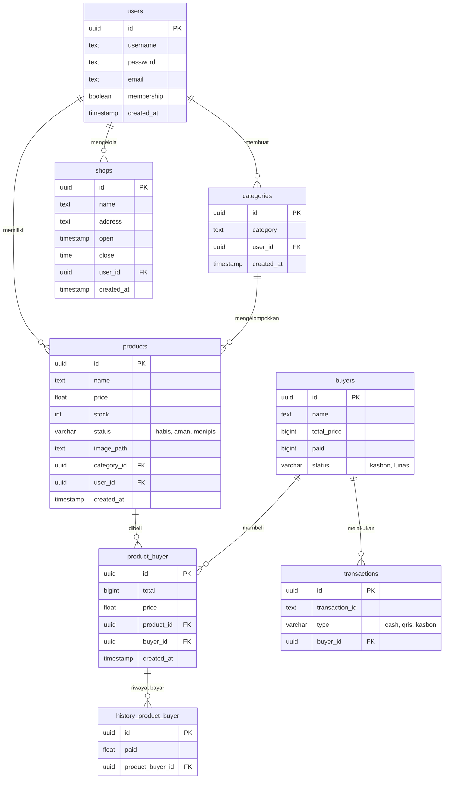
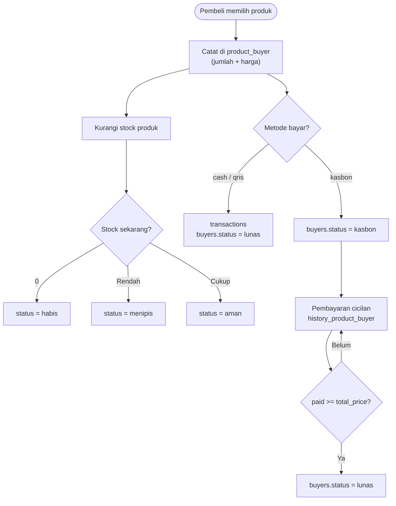

# Panduan Arsitektur & Setup Next.js (TypeScript + Tailwind CSS)

Dokumen ini berisi panduan standar arsitektur fullstack **Next.js (App Router)** dengan **TypeScript** dan **Tailwind CSS**, lengkap dengan struktur direktori, pemisahan layer, serta rekomendasi library.

---

## 1. Pohon Direktori Proyek (Project Tree)

```text
my-next-project/
├── .env
├── .env.local
├── next.config.mjs
├── package.json
├── tsconfig.json
├── tailwind.config.ts        # Konfigurasi Tailwind CSS
├── postcss.config.mjs        # Konfigurasi PostCSS
├── public/                 # Aset statis (gambar, font, favicon)
│   └── images/
│
└── src/
    ├── actions/            # Backend Internal (Server Actions)
    │   ├── auth.ts         # Mutasi data form, cookies, & redirect
    │   └── user.ts         # Mutasi data user dari UI
    │
    ├── app/                # Next.js App Router & Global Styling
    │   ├── (auth)/         # Route Group: Halaman Auth (login, register)
    │   │   ├── login/
    │   │   │   └── page.tsx
    │   │   └── layout.tsx
    │   │
    │   ├── (dashboard)/    # Route Group: Halaman Privat / Admin
    │   │   ├── dashboard/
    │   │   │   └── page.tsx
    │   │   └── layout.tsx  # Layout persisten (Sidebar + Navbar Tailwind)
    │   │
    │   ├── api/            # REST API / Webhooks (Eksternal Client)
    │   │   └── v1/
    │   │       ├── webhooks/
    │   │       │   └── route.ts
    │   │       └── users/
    │   │           └── route.ts
    │   │
    │   ├── globals.css     # Directives Tailwind CSS (@tailwind base, etc.)
    │   ├── layout.tsx      # Root Layout (<html>, <body>, Providers)
    │   └── page.tsx        # Landing Page Utama
    │
    ├── components/         # Frontend UI Components (Tailwind Styled)
    │   ├── layouts/        # Layout besar (Navbar, Sidebar, Footer)
    │   ├── modules/        # Komponen fitur spesifik (UserTable, StatCard)
    │   └── ui/             # Komponen atomic/primitif (Button, Input, Modal via Shadcn/Tailwind)
    │
    ├── lib/                # Konfigurasi Library & Koneksi
    │   ├── db.ts           # Instance ORM Database (Prisma / Drizzle)
    │   └── utils.ts        # Helper `cn()` untuk penggabungan class Tailwind (clsx + tailwind-merge)
    │
    ├── services/           # Business Logic Layer (Logika bisnis & Query DB)
    │   ├── auth.service.ts
    │   └── user.service.ts
    │
    └── types/              # Type Definition / Interface global TypeScript
        └── user.type.ts
```

### Diagram Struktur Direktori



---

## 2. Implementasi & Integrasi Tailwind CSS

### A. Pengaturan File Utilitas (`src/lib/utils.ts`)
Gunakan kombinasi `clsx` dan `tailwind-merge` untuk menangani *conditional class styling* dengan Tailwind tanpa *conflict*:

```typescript
import { ClassValue, clsx } from "clsx";
import { twMerge } from "tailwind-merge";

export function cn(...inputs: ClassValue[]) {
  return twMerge(clsx(inputs));
}
```

### B. Pengaturan Global CSS (`src/app/globals.css`)
```css
@tailwind base;
@tailwind components;
@tailwind utilities;

@layer base {
  body {
    @apply bg-slate-50 text-slate-900 antialiased;
  }
}
```

---

## 3. Daftar Library & Dependensi yang Dibutuhkan

| Kategori | Library / Tool | Kegunaan |
| :--- | :--- | :--- |
| **Styling Core** | `tailwindcss`, `postcss`, `autoprefixer` | Framework CSS berbasis utility-first. |
| **Tailwind Utilities** | `clsx`, `tailwind-merge`, `tailwind-variants` | Menggabungkan class Tailwind secara dinamis & mengelola varian komponen. |
| **UI Components** | `shadcn/ui`, `lucide-react` | Komponen primitif accessible bertema Tailwind + Set Icon modern. |
| **ORM & Database** | `@prisma/client`, `prisma` | Pemetaan data database bertipe TypeScript (atau Drizzle ORM). |
| **Form & Validasi** | `zod`, `react-hook-form`, `@hookform/resolvers` | Validasi skema di Server Actions & pengolahan form di UI. |
| **Auth & Security** | `next-auth`, `bcryptjs` | Manajemen sesi/cookies & enkripsi password. |

### Diagram Kategori Library



---

## 4. Perintah Instalasi Terminal (All-in-One)

Jalankan perintah berikut di terminal untuk memasang semua library yang dibutuhkan sekaligus:

```bash
# 1. Install dependensi utama (Styling, UI, Validasi, Auth, ORM)
npm install lucide-react clsx tailwind-merge zod react-hook-form @hookform/resolvers bcryptjs next-auth@beta @prisma/client

# 2. Install devDependencies
npm install -D prisma @types/bcryptjs tailwindcss postcss autoprefixer

# 3. Inisialisasi konfigurasi Prisma & Shadcn UI
npx prisma init
npx shadcn@latest init
```

### Diagram Alur Setup



---

## 5. Ringkasan Alur Kerja Layer (FE & BE)

$$\text{UI (Tailwind Component)} \longrightarrow \text{Server Action (`actions/`)} \longrightarrow \text{Business Logic (`services/`)} \longrightarrow \text{Database (`lib/db.ts`)}$$

1. **Frontend (View)**: Tampilan UI dibentuk menggunakan class Tailwind di dalam `src/components/` atau `src/app/`.
2. **Server Actions (`src/actions/`)**: Memproses data form kiriman pengguna di server, menangani `revalidatePath()`, dan `redirect()`.
3. **Services (`src/services/`)**: Menjalankan enkripsi data, kalkulasi, serta eksekusi query ke database via `lib/db.ts`.

### A. Diagram Arsitektur Layer



### B. Diagram Sequence: Proses Login



### C. Diagram Routing (App Router)



---

## 6. Diagram Database (ERD)

Berikut Entity Relationship Diagram yang dihasilkan dari file `drawSQL-pgsql-export-2026-11-05.sql`. Skema ini mengarah ke aplikasi toko/kasir (produk, pembeli, kasbon, transaksi).



### Diagram Alur Bisnis (Penjualan & Kasbon)


